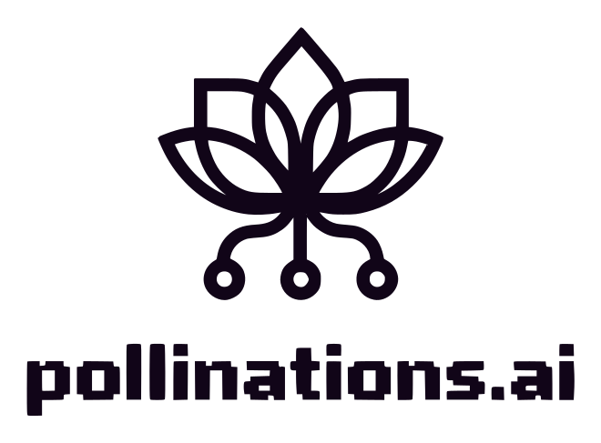
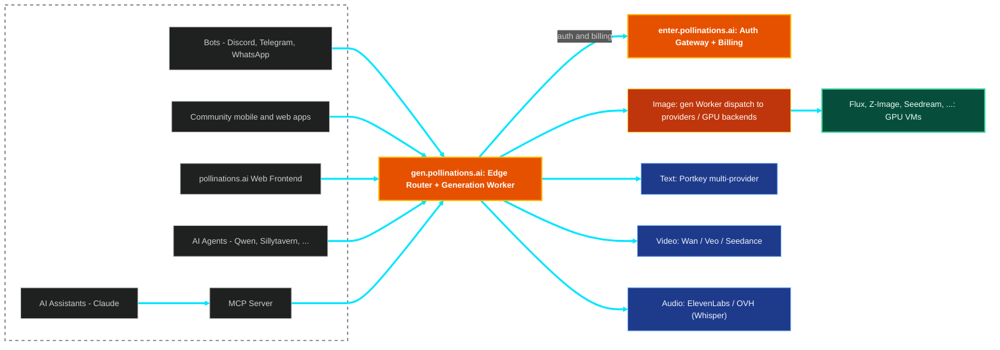
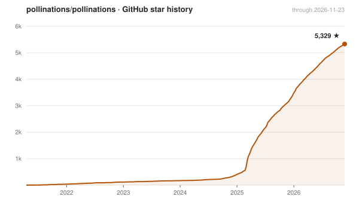

<div align="center">
  <picture>
    <source media="(prefers-color-scheme: dark)" srcset="packages/ui/src/brand/lockup-stacked-white.svg" />
    
  </picture>
  
  <p><strong>Open-source AI for people who make things.</strong></p>

[](https://github.com/pollinations/pollinations/stargazers)
[](LICENSE)
[](https://discord.gg/k9F7SyTgqn)

[Ecosystem](#ecosystem) · [Get involved](#get-involved) · [Playground](https://pollinations.ai/play) · [Community apps](https://pollinations.ai/apps) · [API docs](https://gen.pollinations.ai/docs) · [Explore the code](#-project-structure)

</div>

<p align="center"></p>

## Ecosystem

Try a model in the [playground](https://pollinations.ai/play), build it into an app, or publish your own model or agent. This repository holds the code that runs Pollinations.ai.

| Feature | What you can do |
| --- | --- |
| [Models](https://enter.pollinations.ai/models) | Create text, images, video, audio, and 3D assets. Use embeddings for search or realtime models for live conversations. |
| [Community models](#-community-models) | Bring a model you host to the catalog and set its price. |
| [Community agents](#-community-agents) and [MCP tools](https://gen.pollinations.ai/docs#tag/mcp-servers) | Give an agent instructions and tools, then call it from your app by name. |
| [Sandboxes](https://gen.pollinations.ai/docs#tag/sandboxes) | Run code on a Linux machine. Connect over SSH or VS Code to install packages, test, and preview your app. |
| [Sites](https://gen.pollinations.ai/docs#tag/sites) and [media storage](APIDOCS.md#media-storage) | Publish a static site at `your-name.pollinations.app` and upload media to share by URL. |
| [Pollinations Pay](https://gen.pollinations.ai/docs#tag/pollinations-pay) | Let people set a spending limit and use their own balance in your app. |
| [SDK](./packages/sdk), [CLI](./packages/polli-cli/README.md#first-result), and [coding assistants](./CODING_HARNESSES.md) | Work from your app, terminal, or editor with the same models. |
| [Safety checks](https://gen.pollinations.ai/docs#tag/safety) | Choose which checks run before a prompt reaches the model. |

## Get involved

- **Share what you built.** [Submit an app to the gallery](https://github.com/pollinations/pollinations/issues/new?template=app-submission.yml), [publish a model](./BRING_YOUR_OWN_MODEL.md), or [share an agent](./BUILD_YOUR_OWN_AGENT.md).
- **Solve an issue.** Pick an [open issue](https://github.com/pollinations/pollinations/issues), test your fix, and link the issue in your PR with `Fixes #123`. For example, [PR #19797](https://github.com/pollinations/pollinations/pull/19797) fixed [#19792](https://github.com/pollinations/pollinations/issues/19792) so the playground remembers your prompt after sign-in. [Contributor guide](./CONTRIBUTING.md)
- **Meet other builders.** Show your work in **#showcase**, ask a question in **#code-help**, or [report a bug on GitHub](https://github.com/pollinations/pollinations/issues/new/choose). [Join Discord](https://discord.gg/k9F7SyTgqn)

### Earnings and Quests

- **Model publishers** set a price for a public model and receive 75% of what others spend on it as account balance. [Model pricing](https://gen.pollinations.ai/docs#tag/publish-a-model)
- **App developers** can enable earnings on an app key. A request with a $1.00 base cost then costs the user $1.25 and adds $0.25 to the developer’s balance. [App earnings](https://gen.pollinations.ai/docs#tag/pollinations-pay)
- **Contributors** can claim Quest balance for completing a listed task. For a coding Quest, link your PR to the issue. Once maintainers select and merge it, claim the reward in the [Quests dashboard](https://enter.pollinations.ai/quests).

## 🧩 Community Models

[Try a model hosted by another builder](https://enter.pollinations.ai/models?q=source%3Acommunity), or [connect your own endpoint](./BRING_YOUR_OWN_MODEL.md). You run the model. Pollinations handles discovery, authentication, and billing.

Keep your endpoint private or publish it to the catalog. Choose up to three compatible backups and track uptime on the [model monitor](https://model-monitor.pollinations.ai).

<p align="center"></p>

## 🤖 Community Agents

Give an agent instructions, a base model, and tools, or write it in a single `agent.ts` file. Pollinations can run it for you, or you can connect an agent you host. Call any [published agent](https://enter.pollinations.ai/agents) as `owner/agent-name`.

Start private in [My listings](https://enter.pollinations.ai/my-models). With publisher access, you can share your agent. Managed agents charge callers only for the models and tools they use. [Publish an agent](./BUILD_YOUR_OWN_AGENT.md)

## 🖥️ Playground

Try a prompt in the [playground](https://pollinations.ai/play). Switch models or adjust the settings to see how the result changes.

<p align="center"></p>

## Try the API

Use one secret key for official models, community models, and agents. [Create a key](https://enter.pollinations.ai/keys), set it as `POLLINATIONS_API_KEY` in your shell, then save your first image:

```bash
curl --fail -H "Authorization: Bearer $POLLINATIONS_API_KEY" \
  'https://gen.pollinations.ai/image/a%20garden%20at%20dusk' -o garden.jpg
```

Keep your `sk_` key on your server or in your shell. A public `pk_` key identifies your app during sign-in. [Authentication](APIDOCS.md#-authentication)

**More examples:** [Text](APIDOCS.md#text) · [Video](APIDOCS.md#video) · [Speech](APIDOCS.md#audio) · [Transcription](APIDOCS.md#-multipart-uploads-in-depth) · [3D](APIDOCS.md#3d) · [Embeddings](APIDOCS.md#embeddings) · [Realtime](APIDOCS.md#realtime)

**Client guides:** [Python and Node.js](APIDOCS.md#-use-any-openai-sdk) · [Vercel AI SDK](APIDOCS.md#-vercel-ai-sdk) · [MCP servers](https://gen.pollinations.ai/docs#tag/mcp-servers) · [Index for agents](https://gen.pollinations.ai/llms.txt)

<!-- recent-apps:start -->
## 🆕 Recent Apps

| Name | Description | Author |
|------|-------------|--------|
| [🎬 Creator Studio for TikTok](https://www.mrpaloma.com/en/creator-studio-tiktok) | Edit subtitles and export videos for TikTok in your browser. Sign in with Pollinations to generate vertical covers, titles, and descriptions using your own balance. | [@rapidbuildlabai](https://github.com/rapidbuildlabai) |
| [🖼️ Pollinations Image Studio](https://palmunix.github.io/pollinations-image-studio) | Gere imagens com IA direto no navegador usando o seu próprio saldo Pollinations. Escolha modelo e proporção, conecte sua conta e crie imagens sem precisar colar chaves. | [@palmunix](https://github.com/palmunix) |
| [🛠️ polli-bridge](https://aibridge.bot.nu) | One OpenAI-compatible /v1 endpoint in front of Pollinations: text, images, speech, transcription, video. Self-hosted or try the live demo, one key per caller, MIT. | [@BalTac](https://github.com/BalTac) |
| [🎮 Decision Arena — Grid Rush](https://decisionarena.edgeone.cool) | A game that AI models play. Decision models on Pollinations play Grid Rush, a deterministic snake-like collection game, and you watch them race. | [@NamanSoni78](https://github.com/NamanSoni78) |
| [🎮 Herd Check](https://patbing.github.io/herd-check) | Nine models get one question that code can answer. See the anonymous vote, pick the answer you trust, then reveal who was right. 66 recorded rounds: the herd never lost. BYOP. | [@patbing](https://github.com/patbing) |
| [🎮 Schelling Table](https://tomdacatto.github.io/pollinations-schelling-table) | A game AI agents play over MCP: each picks one option in secret and scores for matching others. Connect any MCP agent, or use your balance to seat Pollinations models. | [@tomdacatto](https://github.com/tomdacatto) |
| [📚 Where It Slips](https://tomdacatto.github.io/pollinations-where-it-slips) | A tiny real computer written in code checks a model playing it: every step is diffed cell by cell, so you see where each model first slips. You pay from your own balance. | [@tomdacatto](https://github.com/tomdacatto) |
| [🎮 Idle Hands](https://tomdacatto.github.io/pollinations-idle-hands) | Put up to four Pollinations models on a small island with nothing to do. Plain code runs the world and counts what each one did; a timeline shows every turn. You pay from your own balance. | [@tomdacatto](https://github.com/tomdacatto) |
| [🎮 Read On](https://patbing.github.io/read-on) | Three paragraphs on one topic: one by a person before LLMs, two by a model, one told to write plainly. Find the person, blind. A slop-score detector plays the same round against you. BYOP. | [@patbing](https://github.com/patbing) |
| [🎮 Under Oath](https://patbing.github.io/under-oath) | One AI keeps a sealed word, another gets 20 yes/no questions. Code judges the guess, a referee model re-checks every answer, a hash seals the word. Race the Asker. BYOP. | [@patbing](https://github.com/patbing) |

[Browse all apps →](https://pollinations.ai/apps)
<!-- recent-apps:end -->

## 🆕 Latest News

<!-- Updated daily by .github/workflows/repo-update-readme.yml from the news index. -->
<!-- news:start -->
- [ **HeyGen Decision 1**](https://enter.pollinations.ai/models?q=heygen/heygen-decision-1) <sub>Nov 24</sub><br>Use paid-only `heygen/heygen-decision-1` to get typed Yes/No, Choice, or Score decisions from text, image, audio, or video input through `/alpha/decisions` or chat completions.
- [ **Inkling 2 Mini**](https://enter.pollinations.ai/models?q=thinkingmachines/inkling-2-mini) <sub>Nov 24</sub><br>Use paid-only `thinkingmachines/inkling-2-mini` with text or image input, tools, JSON responses, reasoning parameters, and a 1,048,576-token context window.
- [ **Auto mode for sandboxes**](https://gen.pollinations.ai/docs) <sub>Nov 24</sub><br>Choose opt-in Auto mode to let an Azure sandbox suspend when idle and resume on a request to a shared port. Leases are prepaid, and the UI has a 10-minute minimum duration.
-  **Opposite Prompt agent** <sub>Nov 24</sub><br>Give Opposite Prompt text or an image and ask for a visual opposite. It can make an image, video, GIF, or vector graphic.
- [ **Discord commands for sandbox ports**](https://gen.pollinations.ai/docs) <sub>Nov 24</sub><br>Share an Azure sandbox port with a Discord application's `discordPublicKey` to accept signed interactions. Verification pings leave the sandbox asleep; slash commands are acknowledged before it wakes and receives the request.
- [ **Kling 4.0 Flash video**](https://enter.pollinations.ai/models?q=kwaivgi/kling-v4.0-flash) <sub>Nov 23</sub><br>Generate paid-only 720p videos with native audio from text or a start image using `kwaivgi/kling-v4.0-flash`, with durations from 3 to 20 seconds.
- [ **Gemini live transcription**](https://enter.pollinations.ai/models?q=google/gemini-3.5-transcribe-live) <sub>Nov 23</sub><br>Stream mono PCM16 audio to paid-only `google/gemini-3.5-transcribe-live` and manually commit each utterance to get interim text and a final verbatim transcript.
- [ **File links for hosted agents**](https://gen.pollinations.ai/docs) <sub>Nov 23</sub><br>Send a public HTTPS `file_url` as an `input_file` part on `/v1/responses` so hosted agents can pass the link to their tools; the file is not fetched, and the full URL reaches the model.
-  **Fresh models for Discord bots** <sub>Nov 23</sub><br>CatGPT now uses GPT-6.1 Terra, while Opposite Prompt uses GPT-6 Luna. Both generate images with GPT Image 2.5 Sunburst and attach them as JPEGs.
- [ **Record and create in Play**](https://pollinations.ai/play) <sub>Nov 20</sub><br>Record, import, and preview media in Play. Image, Video, and Audio keep their drafts when you switch tabs, and model-specific controls cover options such as GIF frames, video sound, and audio stem separation.
<!-- news:end -->

[More news on enter.pollinations.ai →](https://enter.pollinations.ai/news)

## 🗂️ Project Structure

- [`pollinations.ai/`](./pollinations.ai/) — React website.
- [`gen.pollinations.ai/`](./gen.pollinations.ai/) — API routing, generation, and caching.
- [`enter.pollinations.ai/`](./enter.pollinations.ai/) — Authentication, keys, balances, and checkout.
- [`shared/`](./shared/) — Model registries and shared service utilities.
- [`apps/`](./apps/) — Applications maintained here.
- [`operations/`](./operations/) — Dashboards, monitoring, and the [GPU fleet](./operations/infrastructure/gpu/GPU_INSTANCES.md).
- [`media.pollinations.ai/`](./media.pollinations.ai/) — Media uploads and public galleries.
- [`operations/news/`](./operations/news/) — News and social publishing.
- [`packages/polli-cli/`](./packages/polli-cli/) — Command-line tools.
- [`packages/sdk/`](./packages/sdk/) — Client library and React hooks.
- [`packages/mcp/`](./packages/mcp/) — Hosted MCP server handlers.

[@fkom13’s OpenCode plugin](https://github.com/fkom13/opencode-pollinations-plugin) connects OpenCode to Pollinations models.

For development setup and environment management, see [DEVELOP.md](./DEVELOP.md).

[](https://deepwiki.com/pollinations/pollinations)

## Architecture



## 🌍 Our Vision

We want AI tools to be:

- **Open & Accessible**: Explore apps made by the community and use the [contributor guide](./CONTRIBUTING.md) to get involved

- **Transparent & Ethical**: Inspect our code and discuss how the platform works

- **Community-Driven**: Build tools with other developers, creators, and AI enthusiasts

- **Interconnected**: Combine models and services through shared APIs

- **Evolving**: Add new capabilities while keeping the platform open and accessible

<!-- Updated daily by .github/workflows/repo-update-readme.yml.
     Regenerate locally with:
     GITHUB_TOKEN=$(gh auth token) node .github/scripts/star-history-chart.mjs -->
<a href="https://star-history.com/#pollinations/pollinations&Date">
 <picture>
   <source media="(prefers-color-scheme: dark)" srcset=".github/assets/star-history-dark.svg" width="600" />
   <source media="(prefers-color-scheme: light)" srcset=".github/assets/star-history-light.svg" width="600" />
   
 </picture>
</a>

## 🏢 Supported By

<p align="center"></p>

<!-- website-supporters:start -->
[Alibaba Cloud](https://www.alibabacloud.com/) · [Anthropic](https://www.anthropic.com/) · [AssemblyAI](https://www.assemblyai.com/) · [AWS](https://aws.amazon.com/) · [BytePlus](https://www.byteplus.com/) · [Cloudflare](https://developers.cloudflare.com/workers-ai/) · [Daytona](https://www.daytona.io/) · [DigitalOcean](https://www.digitalocean.com/) · [E2B](https://e2b.dev/) · [ElevenLabs](https://elevenlabs.io/) · [Exa](https://exa.ai/) · [Fireworks AI](https://fireworks.ai/) · [Google Cloud](https://cloud.google.com/) · [InferencePort AI](https://inferenceport.ai/) · [io.net](https://io.net/) · [Lambda](https://lambda.ai/) · [Microsoft Azure](https://azure.microsoft.com/) · [Modal](https://modal.com/) · [Nebius](https://nebius.com/) · [NVIDIA](https://www.nvidia.com/en-us/deep-learning-ai/startups/) · [OpenAI](https://openai.com/) · [OpenRouter](https://openrouter.ai/) · [OVHcloud](https://www.ovhcloud.com/) · [Perplexity](https://www.perplexity.ai/) · [RunPod](https://www.runpod.io/) · [Scaleway](https://www.scaleway.com/)
<!-- website-supporters:end -->

## 📣 Stay Connected
[Status](https://model-monitor.pollinations.ai) ·
[News & FAQ](https://enter.pollinations.ai/news) ·
[𝕏 Twitter](https://x.com/pollinations_ai) · [Instagram](https://instagram.com/pollinations_ai) · [LinkedIn](https://www.linkedin.com/company/pollinations-ai) · [Facebook](https://facebook.com/pollinations) · [Reddit](https://www.reddit.com/r/pollinations_ai/) · [YouTube](https://www.youtube.com/c/pollinations)

## 📜 License

pollinations.ai is open-source software licensed under the [MIT license](LICENSE).

---

Made with ❤️ by the pollinations.ai team
